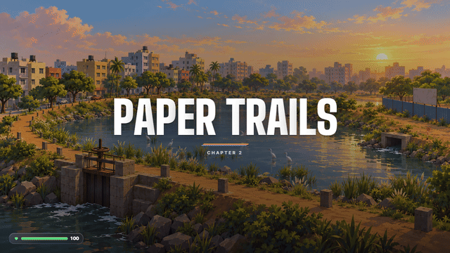
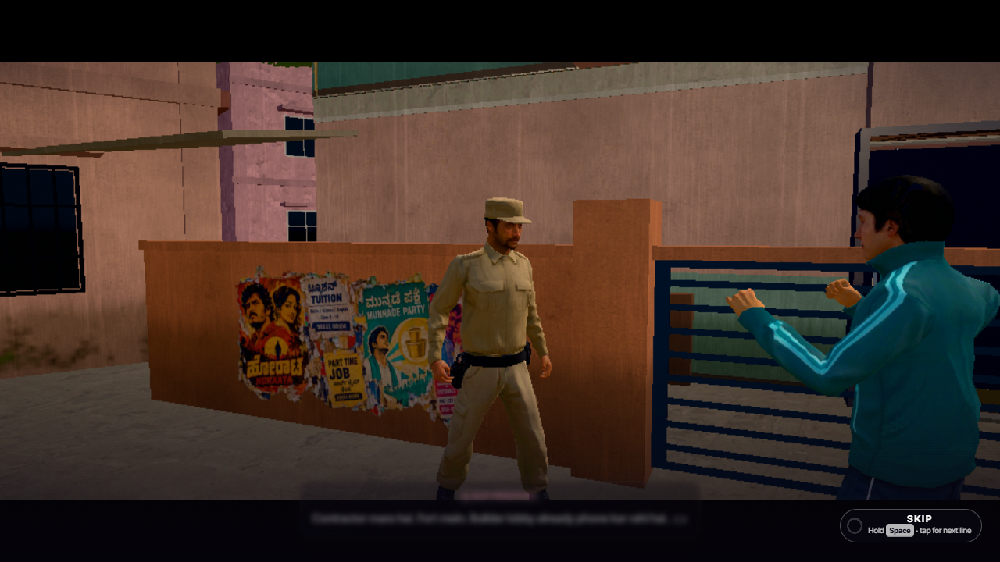
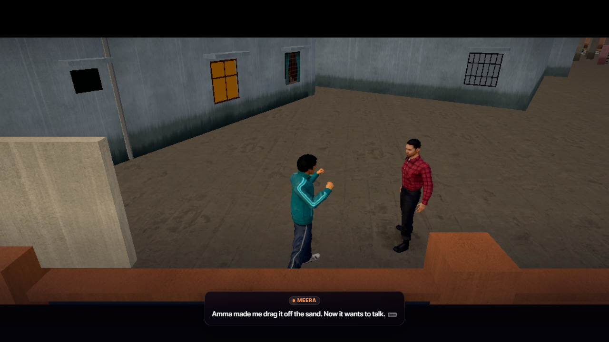
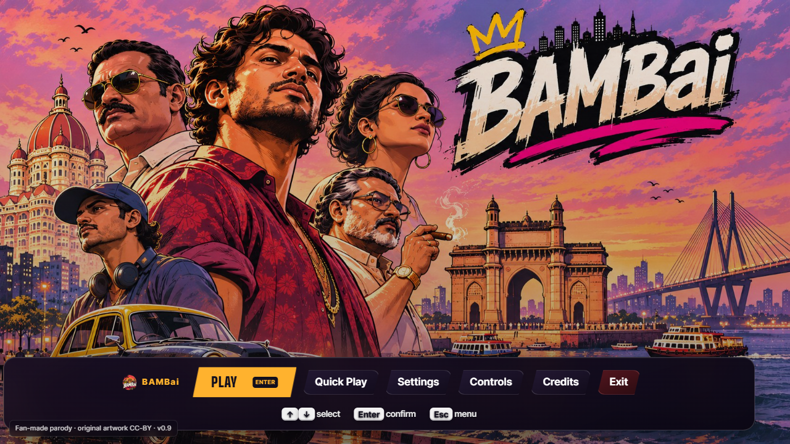
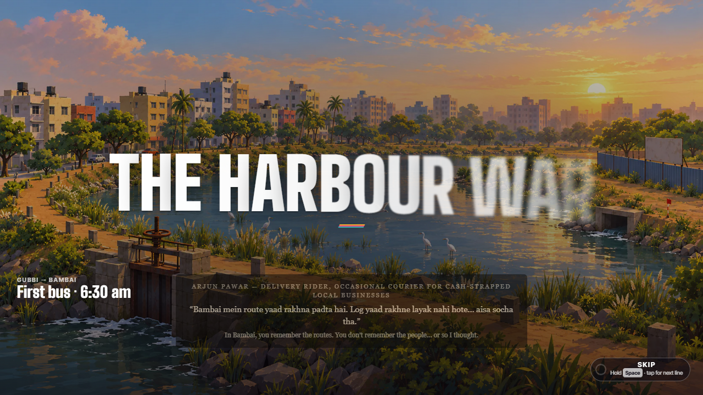
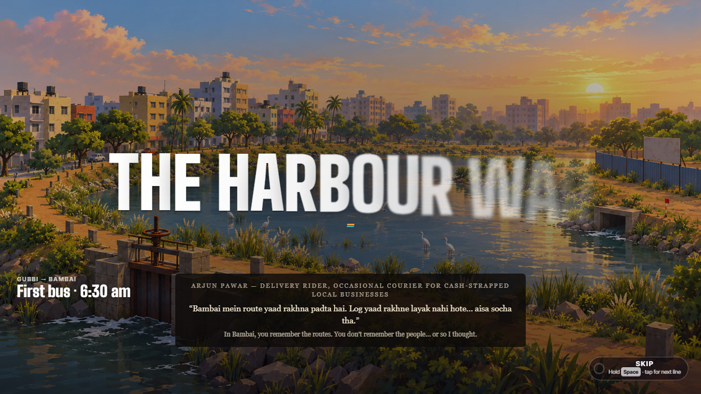
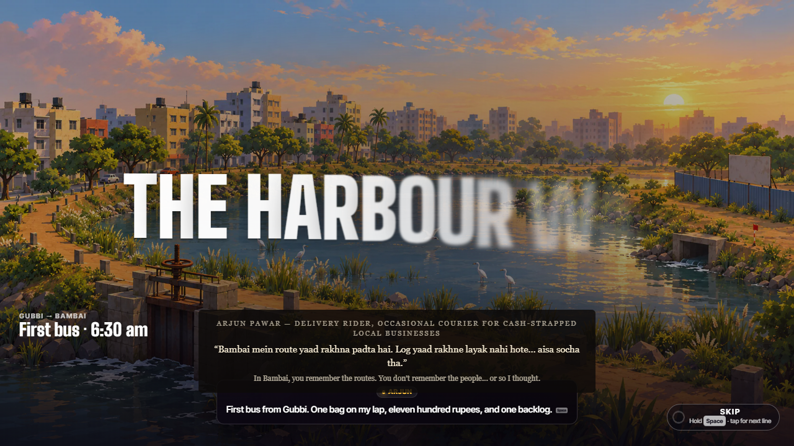
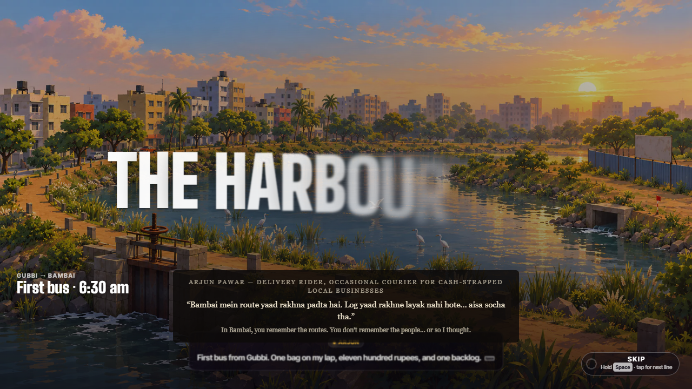
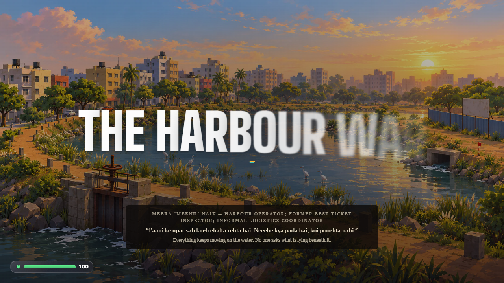

# BAMBai: The City Keeps Secrets

> **An open-world crime thriller set in fictionalised Mumbai. Four people. One city. Four versions of the truth.**

[](docs/chapter-progress.gif)

---

## What this is

BAMBai is a browser-based (Three.js) open-world game. You play through **20 chapters** of a conspiracy about a dying creek, a fake-peg land grab, and the people who profit from keeping the city dirty — through the eyes of **four selectable protagonists**:

| | Protagonist | Lens |
|---|---|---|
| 🕵️ | **Aarav** — Crime Branch detective | The case file. The evidence. The procedure. |
| 🛵 | **Arjun** — food-delivery rider | The streets. The routes. The people. |
| 📰 | **Naina** — investigative journalist | The story. The leak. The byline. |
| ⛵ | **Meera** — dock fix-caller | The harbour. The tide. The truth below the waterline. |

Same conspiracy, four routes through it — different missions, different witnesses, different endings.

## The story in one paragraph

Vikram Salvi is found dead in an unfinished tower in Backbay. The official story is an accident. The real story is a dying creek (Retibandar), a land grab built on fake survey pegs, and a mafia (Rakshas Group) filling the creek with contaminated drums by night. Four people see the same conspiracy from four sides: a detective, a courier, a journalist, and a dock fix-caller. The city keeps secrets. They stop carrying them.

## What's in the build

- **20 chapters · 48 core missions** across four protagonists + **12 side missions** (S0–S11) + world-state flags (press burnt, accounts frozen, case files reassigned)
- **Real OSM South Mumbai**: Kolvada (Colaba), Moti Haar Marg (Marine Drive), Fort/CSMT, Mota Bazaar, Backbay, the creek — 534 blocks, 3,151 footprints, sea polygon, monsoon/flood weather
- **7 radio stations** + the **Varli Prasarayan Tower** ("Mother Tower") skyline landmark + Koliwada community mast + pirate Bambai After Dark
- **4 endings** decided by your evidence/trust/loyalty/compromise vars: *The Paper · The Badge · The Empire · The Rakshasa*
- **Full four-protagonist campaign**: character select, per-lead missions, chapter cards, bulletin radio, case-board evidence, bonds
- **Mumbai identity**: BEST red double-deckers, black-and-yellow autos, real fares, Maharashtra festivals (Dahi Handi, Gudi Padwa), Devanagari fonts, Bambaiya/Hale/Traffic radios — no Kanglish

## Screenshots (real gameplay, headless-Edge probes)

| | |
|---|---|
|  |  |
| *Ch 1 — The Body at Backbay* | *Ch 1 — The Drum* |
|  |  |
| *Monsoon at 15:00* | *23:00 — the city after dark* |
|  |  |
| *Ch 6 — The Harbour War* | *Ch 7 — Platform Six* |
|  |  |
| *Ch 8 — The Western Ledger* | *Ch 10 — The Other Side of the City* |
|  |  |
| *Ch 15 — The Harbour Beyond* | *End of Act I — The First Body* |

## How to run

```bash
# serve the static build
node preview.mjs 8485
# → http://127.0.0.1:8485/
```

Or with the dev server (HMR, story-layer hooks):

```bash
pnpm install
pnpm run dev        # vite on :5173
```

**Boot:** the loading bar eases asymptotically (fake progress); the city build is CPU-bound (OSM geometry + 95 preload GLBs) — a cold boot takes ~6–10 min on a slow disk; subsequent boots reuse the module cache. If it stalls, wait it out; the bar is cosmetic (`bn=[.05,.15,.45,.7,1]`).

## Deep links

- `?who=aarav|arjun|naina|meera` — select protagonist at boot
- `?mission=11` — start at story chapter 11
- `?chapter=6` / `?lead=` — reserved (P10)
- `?story=1` — story-state debug handle (`window.__storyState`)

## Repo layout

```
vendor/          # shipped Three.js bundle (served raw; edits mirrored to _source/)
story/           # four-protagonist campaign data (chapters, missions, endings, radio, dialogue)
reference/osm/   # real OSM pipeline (Overpass → stage1/23/4 → map.js)
reference/story/ # probes + validation scripts (headless Edge)
art/, brand/, assets/  # art, brand, GLBs, audio
BAMBai-GRAND-DESIGN.md   # canonical design bible
BAMBAI-PHASES.md         # four-protagonist production phases
BAMBai-STORY-PHASES.md   # S0–S11 execution log
```

## Development

- **Stack:** Three.js r186-era, custom physics (Rapier), static ESM in `vendor/`, Vite dev shell
- **Validation:** `node --experimental-vm-modules` ESM parse (86/86) + headless-Edge probes (`reference/story/probe-*.cjs`) that play chapters and assert cards/evidence/zero page errors
- **Map pipeline:** real Overpass extracts → `osm2map-stage{1,23,4}.mjs` → `vendor/map.js` (fictionalised names via rename maps)
- **Audio:** street/radio WAVs via Windows SAPI (`gen-vo.ps1`, `gen-bulletins.mjs`); bulletin filter = bandpass + acrusher + echo (pirate-radio)

## Status

- ✅ Ch 1–2 (Creek Files) shipped, Ch 3 "Eleven After Eleven" built
- ✅ Ch 4–5 (Harbour Freight → Three Strangers) + Act I cliffhanger wired
- ✅ Ch 6–10 (Act II: Peg Truck → No Case Number) + Act II bulletins (ch6–10)
- ✅ Ch 11–15 (Act III: Stay Order → Belapur Papers)
- ✅ Ch 16–20 (Act IV: Internal Affairs → The City Keeps Secrets, ending calculator wired)
- ✅ 12 side missions (S0–S11) offered + completable
- ⏳ Parallel map session: Central Line Zone B (Dadar→Sion→Kurla) OSM pipeline
- ⏳ Pending: full per-protagonist sweep, human VO re-record, HUD debt-ticker, README art pass

## Credits

- Design: BAMBai team · Fictionalised Mumbai per house rules (real geography, fictional names, real colours/fares)
- Engine: Three.js · Physics: Rapier · TTS: Windows SAPI (David) · Tools: Overpass API, ffmpeg, Playwright (headless Edge)